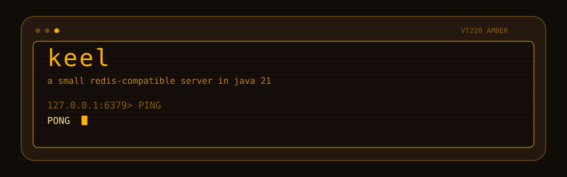
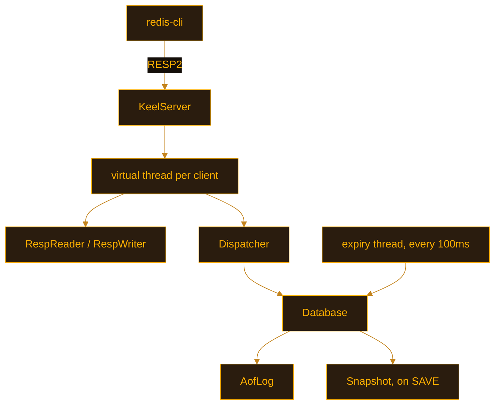

<p align="center">
  
</p>

# keel

A small Redis-compatible server I wrote in Java 21 so I could talk about networking, concurrency, and storage in an interview without waving at a framework.

It listens on port 6379, speaks [RESP2](https://redis.io/docs/latest/develop/reference/protocol-spec/), and the real `redis-cli` can drive it. The idea was inspired by the CodeCrafters "Build your own Redis" challenge. I kept the surface small on purpose: about 2,400 lines of server code, plus tests.

Rajveer Singh.

## Run it

You need JDK 21.

```bash
git clone https://github.com/Rajveerrsingh/keel
cd keel
./gradlew run
```

In another terminal:

```bash
redis-cli
127.0.0.1:6379> PING
PONG
127.0.0.1:6379> SET city Toronto EX 60
OK
127.0.0.1:6379> GET city
"Toronto"
127.0.0.1:6379> INCR visits
(integer) 1
127.0.0.1:6379> LPUSH stack keel java
(integer) 2
127.0.0.1:6379> LRANGE stack 0 -1
1) "java"
2) "keel"
127.0.0.1:6379> HSET dev name Rajveer city Toronto
(integer) 2
127.0.0.1:6379> TTL city
(integer) 60
```

`LPUSH` inserts each element at the head, so `java` ends up in front of `keel`. That matches Redis.

Other ways to start it:

```bash
./gradlew jar
java -jar build/libs/keel.jar --port 6379 --dir data

docker build -t keel .
docker run --rm -p 6379:6379 keel
```

Flags:

| Flag | Default | |
| --- | --- | --- |
| `--port` | `6379` | TCP port |
| `--dir` | `data` | Where the files go |
| `--appendonly` | `yes` | Replay `keel.aof` on startup |
| `--appendfsync` | `always` | `fsync` after every write, or `no` to only flush |
| `--appendfilename` | `keel.aof` | AOF name, inside `--dir` |
| `--dbfilename` | `keel.rdb` | Snapshot name. `SAVE` writes it. Loaded on startup only when `--appendonly no` |

Tests:

```bash
./gradlew test
```

## What it answers

| Command | Notes |
| --- | --- |
| `PING` | `PONG`, or the argument you passed |
| `ECHO` | |
| `SET` | `EX` seconds, `PX` milliseconds, `NX`, `XX` |
| `GET` | |
| `DEL`, `EXISTS` | Several keys. `EXISTS k k` counts twice |
| `INCR`, `DECR` | 64-bit. Missing key starts at 0. Overflow is an error and the old value stays |
| `EXPIRE`, `TTL` | `TTL` is `-1` with no deadline, `-2` if the key is missing |
| `PEXPIREAT` | Absolute expiry in milliseconds. The AOF writes this |
| `KEYS` | Glob: `*`, `?`, `[abc]`, `[a-z]`, `[^a]`, `\` |
| `LPUSH`, `RPUSH`, `LPOP`, `RPOP`, `LRANGE` | |
| `HSET`, `HGET`, `HDEL`, `HGETALL` | `HSET` returns how many fields were new |
| `SAVE` | Writes the snapshot |
| `QUIT` | |
| `CLIENT SETINFO` | `redis-cli` 7.2 sends this on connect. It is accepted and ignored |

A plain line also works, which is what `redis-benchmark` uses for `PING_INLINE` and what you get if you telnet in: `PING`. Quoted inline strings are not parsed. `redis-cli` sends RESP arrays, so that path is the one that matters.

Wrong type, bad arity, and unknown commands come back as Redis-shaped errors (`WRONGTYPE`, `ERR wrong number of arguments...`).

## How it is put together



```
src/main/java/dev/rajveer/keel
  protocol/     RESP2 reader and writer
  store/        keyspace, integers, glob
  commands/     one class per family, plus the dispatcher
  persistence/  AOF and the snapshot
  server/       accept loop and client threads
  bench/        the load test
```

## Decisions

**One virtual thread per client.** The read loop is ordinary blocking code. The JVM parks the thread when the socket is idle, so a few thousand clients do not mean a few thousand OS threads. A `Selector` loop would spend less on thread bookkeeping and would be harder to read line by line. I wanted the readable version.

**One key at a time.** Every read and write of a key goes through `ConcurrentHashMap.compute`. Two `INCR`s on the same key cannot lose an update. Two keys can move together. There is no `MULTI`/`EXEC`. A command that names several keys, like `DEL a b`, does them one after another.

**Expiry is lazy and active.** A read or write that touches a key past its deadline deletes it, so a `GET` never returns a stale value. A background thread also samples keys, because a key nobody reads would sit in the map until process exit. Under 20 keys the pass checks all of them. Above that it shuffles the key set, checks 20, and if more than a quarter were dead it goes again. Copying the key set is the simple way to sample a `ConcurrentHashMap`. A bigger server would walk the table buckets instead.

**The AOF stores an absolute deadline.** `SET k v EX 10` is logged as `SET` plus `PEXPIREAT` with a millisecond timestamp. Replaying `EXPIRE 10` on startup would start the 10 seconds over. `fsync` runs after every logged command (`--appendfsync always`). That is the safe setting and it is slow. See the numbers below. `--appendfsync no` only flushes the buffer to the OS.

**Startup uses one file.** If the AOF is on and the file has commands, those commands are replayed and the snapshot is ignored. If the AOF is off, `SAVE`'s snapshot is loaded. Mixing them would mean a snapshot of old data plus a log that does not contain that data. A torn write at the end of the AOF is cut off so the next append stays aligned.

**The snapshot is not Redis RDB.** `SAVE` writes `KEELSNAP`, a version byte, then records for strings, lists, and hashes, and closes with `0xFF`. It is renamed into place. `redis-server` cannot load it. The RDB opcode set is a project of its own, and this file only has to round-trip through keel.

**RESP2.** `redis-cli` speaks it by default. RESP3 attributes and maps are not needed for these commands.

**Keys are Latin-1 strings.** Every byte maps to one `char` and back, so a binary key still works as a `ConcurrentHashMap` key. Values stay `byte[]`.

**Each reply is flushed.** A client that sent half of the next command, then stopped to read, must not sit behind a buffered reply. Pipelined replies could be merged when a full extra command is already buffered. I flush every time so that case stays simple.

## Benchmarks

Measured on this VM: 4 vCPU, Intel Xeon, Linux, Java 21, keel with `--appendonly no` unless noted. The load test is `dev.rajveer.keel.bench.LoadTest` (32 clients, pipeline 16, 1s warmup, then a timed window, 1000 keys, zero errors). `redis-benchmark` is 7.0.15, 32 clients. It prints `Could not fetch server CONFIG` because keel has no `CONFIG` command. The request rates after that warning are the real ones.

Java load test, 4 seconds, AOF off:

| Mode | ops/sec |
| --- | ---: |
| PING | 769,104 |
| SET | 696,968 |
| GET | 726,748 |
| mixed SET/GET | 700,756 |

`redis-benchmark` against keel, AOF off:

| Test | requests/sec | p50 |
| --- | ---: | ---: |
| SET, no pipeline, 100k requests | 141,243 | 0.135 ms |
| GET, no pipeline, 100k requests | 141,643 | 0.135 ms |
| SET, pipeline 16, 200k requests | 701,754 | 0.599 ms |
| GET, pipeline 16, 200k requests | 760,456 | 0.551 ms |

Same `redis-benchmark` flags against Redis 7.0.15 on this VM, AOF and RDB off:

| Test | requests/sec | p50 |
| --- | ---: | ---: |
| SET, no pipeline | 155,521 | 0.111 ms |
| GET, no pipeline | 155,280 | 0.111 ms |
| SET, pipeline 16 | 1,769,912 | 0.255 ms |
| GET, pipeline 16 | 2,040,816 | 0.215 ms |

With a pipeline of 1, keel is close to Redis on this box. With a pipeline of 16, Redis is a bit over twice as fast. I flush every reply and I parse with a small hand-written reader. Redis batches socket writes and has had years of that path tuned.

SET with the log on, same Java client, 32 clients, pipeline 16, 3 second window:

| AOF | ops/sec |
| --- | ---: |
| off | 696,968 |
| on, `--appendfsync no` | 67,781 |
| on, `--appendfsync always` | 10,528 |

The "off" row is the 4 second run above. The other two are 3 second runs. The gap is the point: an `fsync` per command dominates the CPU work. Redis defaults to `appendfsync everysec` for that reason. I did not build the background flusher.

Reproduce:

```bash
./scripts/bench.sh
```

## Tests

JUnit 5. 47 tests.

- RESP reader and writer, including null bulk, embedded CRLF, and a truncated frame
- Integer rules Redis actually uses (no leading zeros, no `+`, `Long.MIN_VALUE` works)
- Glob
- Every command family, wrong types, and `NX` / `XX`
- Lazy expiry with a fake clock, and the active sampler
- AOF replay, including a file whose tail was torn
- `SAVE` / load, including a value with `NUL` and `0xFF`
- A real socket: pipelining, `QUIT`, two clients `INCR`ing one key, inline `PING`, and `redis-cli` when it is installed

GitHub Actions runs `./gradlew test` on Java 21 and installs `redis-cli` so that last test runs there too.

## If I were walking someone through it

I would open `KeelServer`, then `Database.set` / `Database.incr`, then `AofLog`, and stop. The rest is command parsing.

Things I would say out loud:

- Virtual threads made the accept loop look like the blocking servers in the Java tutorials, and they still scale past one thread per connection in the old sense.
- `compute` is the whole concurrency story. If the update throws, the map keeps the previous entry, so a bad `INCR` does not wipe the key.
- Lazy expiry is what makes reads correct. Active expiry is what keeps memory honest. The 20-key sample is the same idea as Redis, with a simpler way of picking keys.
- Relative TTLs in a log lie across restarts. Absolute `PEXPIREAT` does not.
- The 10k vs 700k gap is why "sync the disk every write" needs a sentence in the design doc.
- `KEYS` walks the whole map. Redis added `SCAN` because of that. I would add `SCAN` before I added more types.
- I skipped replication. `REPLICAOF` needs a backlog, an offset, and a story for what happens when the replica was down. That would have buried the parts I actually want to explain.

## Left out

Replication, RESP3, `MULTI`/`EXEC`, eviction under `maxmemory`, AOF rewrite, `SCAN`, and the real RDB format. Each of those is a reasonable next file. None of them belong in the first read.
